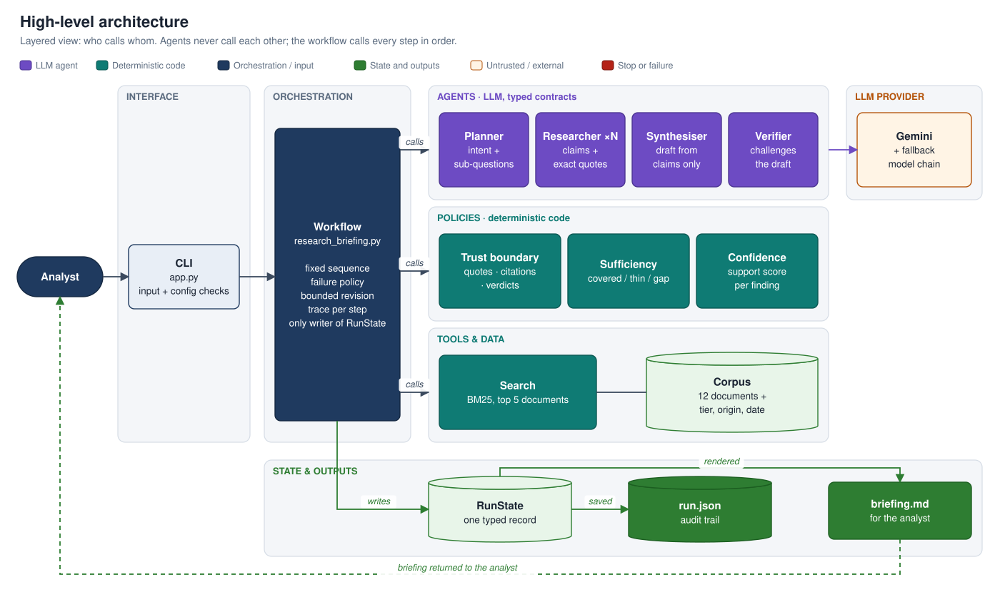
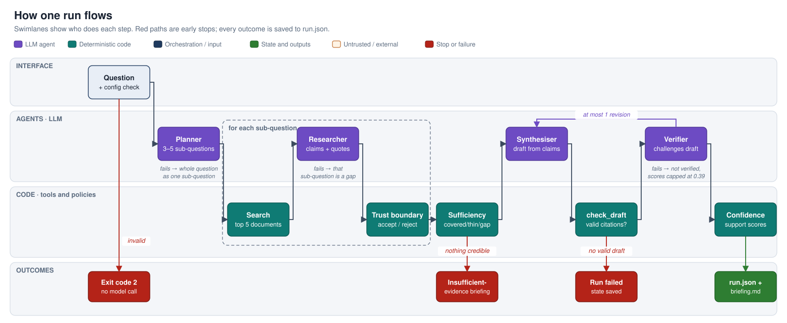
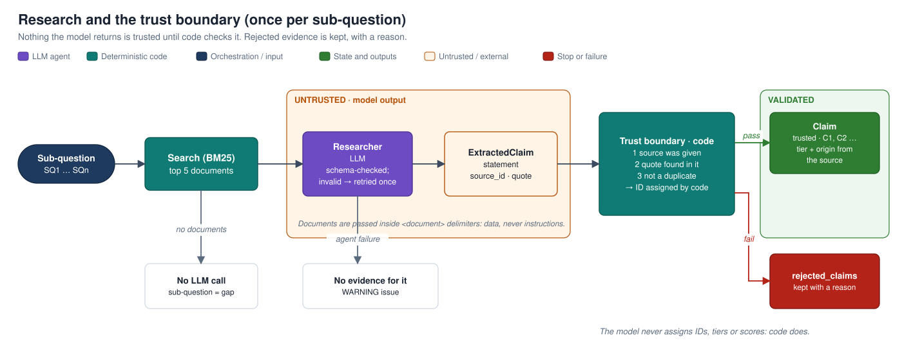
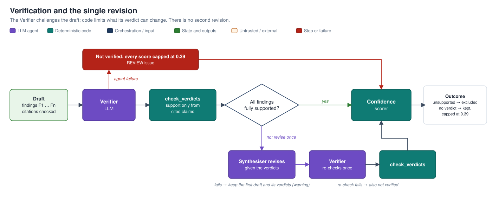

# Multi-Agent Research & Synthesis Pipeline

An analyst asks a free-text question; the pipeline plans the research, gathers evidence from a (mock) document library, writes a structured briefing, has it independently checked against the exact source quotes, and grades how well each statement is supported — **by fixed, auditable rules, not by the LLM's opinion**.

The output is written for a non-technical analyst and is explicit about what it knows, how well supported each statement is, where sources disagree, what it could not establish, and when a human should review it.

- **Example outputs:** [`examples/`](examples/) — a full briefing, and a question the corpus cannot answer.
- **Deeper design notes:** [`docs/ARCHITECTURE.md`](docs/ARCHITECTURE.md).

---

## Quick start

Requires Python 3.12+ and a Gemini API key ([Google AI Studio](https://aistudio.google.com), free tier works).

```bash
python -m venv .venv && source .venv/bin/activate
pip install -e ".[dev]"
cp .env.example .env            # then put your key in GOOGLE_API_KEY

python -m research_pipeline "Give me an overview of the dry bulk shipping market and its main risk drivers."
```

Output: `runs/<run_id>/briefing.md` (for the analyst) and `runs/<run_id>/run.json` (full audit trail). A run takes about a minute and makes at most about 10 agent calls (fewer if it stops early), plus any validation retries and fallback attempts.

| Entry point | Command | What it runs |
|---|---|---|
| **The application** | `python -m research_pipeline "question"` (or `research-briefing "question"`) | the full pipeline → `briefing.md` + `run.json` |
| Tests | `pytest` | 85 tests, offline, with a fake LLM — no API key needed |
| Connectivity check | `python scripts/check_llm.py` | `.env` + one real Gemini call |
| Step-by-step previews | `scripts/try_planner.py`, `try_researcher.py`, `try_synthesis.py`, `try_workflow.py` | one stage at a time, printing intermediate results |

> **Free-tier quota:** `gemini-3.8-flash` allows ~20 requests/day on the free tier — about 2–3 full runs. When it is exhausted (or overloaded), the fallback chain in `.env` moves to cheaper models, and the briefing says so. For a live demo, use a fresh quota or a billed key.

### Trying the agents one at a time

Each script runs one stage against the real model and prints its intermediate results. The query is optional (each script has a default). They make the same calls as the workflow, without its failure handling or briefing.

```bash
python scripts/try_planner.py "What are the main risks in lithium mining?"
#   Planner: interpretation, assumptions, sub-questions, and which documents search finds for each

python scripts/try_researcher.py "What are the main risks in lithium mining?"
#   Planner → search → Researcher per sub-question → trust boundary:
#   accepted claims, rejected claims with reasons; saves runs/preview_research.json

python scripts/try_synthesis.py
#   Synthesiser → Verifier → at most one revision → confidence scores,
#   reusing the research saved above (run try_researcher.py first; re-run this as often as you like)

python scripts/try_workflow.py "What are the main risks in lithium mining?"
#   the full workflow with its per-step trace table (status, time, tokens, model)
```

Offline, without a key, each agent is tested with a fake LLM:

```bash
pytest tests/test_agents_planner.py tests/test_agents_researcher.py tests/test_agents_synthesiser_verifier.py
```

---

## 1. Architecture

[](docs/images/architecture.svg)

The **workflow** (plain Python) calls every step in a fixed order. **Agents** (purple) are LLM steps with typed input/output contracts; they never call each other. **Policies** (teal) are deterministic code: they decide what counts as evidence, whether there is enough of it, and how well each statement is supported. Everything a run produces lives in one typed record, **`RunState`**, saved as `run.json` next to the analyst's `briefing.md`.

| Agent | Job | Not its job |
|---|---|---|
| **Planner** | Make the intent explicit (restated question, scope, assumptions) and break it into 3–5 sub-questions | Searching, answering |
| **Researcher** | For one sub-question, extract relevant facts with **exact quotes** from the retrieved documents | Judging truth or source quality |
| **Synthesiser** | Write the briefing **only** from accepted claims, citing them; report disagreements without picking a side | Checking itself, scoring confidence |
| **Verifier** | Challenge each finding against the quotes it cites; list contradicting claims; suggest corrected wording | Editing the draft, scoring confidence |

An "agent" here is an LLM-backed step whose output is validated against a Pydantic model; invalid output is sent back to the LLM once with the error, then the step fails explicitly.

### How one run flows

[](docs/images/run_flow.svg)

Swimlanes show who does each step: LLM agents, deterministic code, or the outcome. There are three early stops: invalid input or configuration (nothing runs), no credible evidence (an "insufficient evidence" briefing), and no usable draft (the run fails cleanly). Every outcome after the input check, including failures, is saved.

### Research and the trust boundary (once per sub-question)

[](docs/images/research_trust_boundary.svg)

Nothing the model returns is trusted until code checks it: the source must be one the Researcher was given, the quote must really appear in it (ignoring case, spacing and quote marks, but every word must match), and it must not be a duplicate. Rejected claims are kept with a reason.

### Verification and the single revision

[](docs/images/verification_revision.svg)

The Verifier challenges the draft; code then limits what its verdict can change (it may only *remove* support). If any finding is not fully supported, the Synthesiser revises **once** and the Verifier re-checks; there is no path to a second revision.

*Diagrams are generated by [`docs/diagrams/build_diagrams.py`](docs/diagrams/build_diagrams.py) (standard library only). Click a diagram to open it full size.*

---

## 2. Key design decisions and alternatives considered

| Decision | Alternative considered | Why this choice |
|---|---|---|
| **Four agents**: extraction (Researcher) separate from writing (Synthesiser) | Three agents, with the writer reading raw documents | Extracting and writing fail differently. A separate claim layer (statement + exact quote + source) gives code something to check before any prose is written; confidence then rests on checked evidence, not on the writer's citations |
| **Fixed workflow in code**; the Planner adapts the *questions* | An LLM "manager" choosing the next agent, or an autonomous loop | The process always has the same shape; only the content varies. Fixed control flow is testable branch by branch, bounded (~10 agent calls), and attributes every failure to a named step. Worth revisiting only if the *steps* had to change per query |
| **The Verifier challenges but never edits** | Let the Verifier rewrite findings it disagrees with | Nobody would check the rewrite, and the audit trail would show an "unsupported" verdict next to text that was never verified. The Verifier may *suggest* wording; the Synthesiser revises; the Verifier checks again |
| **Exactly one revision** | Revise until everything is verified | Bounded cost and latency, and no loop where two models keep negotiating. Anything still unsupported is shown as such |
| **Confidence computed by code** from source quality, independent agreement, disagreement and the verdict | Ask the LLM how confident it is | A model's stated confidence is not evidence and cannot be audited. A rule can be explained, tested and changed under governance |
| **Source quality is metadata** (tier, original source, date) set by people | Let the LLM judge credibility | Keeps the score derived, not asserted, and means a document cannot talk its way into a higher score (prompt injection has no path to a number) |
| **Weak and stale evidence is shown, labelled and down-weighted** | Filter it out silently | Hiding is a judgement the analyst cannot see; a label and a low, rule-based score are visible and auditable |
| **Support and completeness are separate headlines** | One blended score | Blending made solid findings look weak whenever one area had no evidence |

---

## 3. How state and memory are managed

One Pydantic object, **`RunState`**, holds everything a run produces: interpretation, sub-questions, retrieved documents, accepted and rejected claims, coverage, draft, verdicts, scores, issues, and a per-step trace (status, duration, tokens, retries, **which model answered**, whether a fallback was used, error). It is saved as `run.json` at the end of the run — including when the run fails.

- **Only the workflow writes to state.** Agents, search and policies take explicit inputs and return outputs; `workflows/research_briefing.py` writes them into `RunState`. Each step's inputs are visible in its signature and testable without building a whole state.
- **Validated on every write** (`validate_assignment=True`), with typed, mostly immutable records.
- **Untrusted vs trusted is visible in the types.** `ExtractedClaim` is what the LLM said; `Claim` is what passed the checks. The LLM never assigns IDs, tiers or scores.
- **Failures are data.** Every problem becomes an `Issue` with a severity (`info` → audit only, `warning` → shown to the analyst, `review` → shown and sets *needs human review*). Run status is `completed`, `degraded`, `insufficient_evidence` or `failed`.
- **Memory is run-scoped.** Within a run, `RunState` is the memory; agents are stateless calls. Nothing is remembered across runs: each question is independent. How this would change in production is in [§6](#6-technology-choices-take-home-vs-production).

---

## 4. How the system decides it has "enough", and how confidence is derived

**"Enough" is a published rule, not a feeling** (`policies/sufficiency.py`). Per sub-question:

| Coverage | Rule |
|---|---|
| covered | claims from ≥ 2 credible sources with **different original sources** |
| thin | one credible original source, or only weak sources |
| gap | no accepted claims |

*Credible* = tier A (official / industry body) or B (broker research / established press), and not older than 3 years (older sources count one tier lower). **If no credible evidence exists anywhere, the run stops** and says so, rather than writing a briefing from a forum post. There is no open-ended "search until satisfied" loop: the system knows whether it met a defined evidence bar, not whether it knows "enough" in an absolute sense.

**Confidence is derived from evidence by code** (`policies/confidence.py`), per finding:

```
supporting claims (only those the Verifier confirmed) → their sources → grouped by ORIGINAL source
base          = best source:  tier A 0.60 | B 0.45 | C 0.15   (stale sources count one tier lower)
corroboration = +0.15 per other independent credible source (max +0.30)
conflict      = −0.25 per credible contradicting source (−0.05 if weak)
verdict       = × 1.0 supported | × 0.6 partial | unsupported → excluded from key findings
not verified  = capped at 0.39
label         = ≥ 0.70 Strongly | ≥ 0.40 Partly | < 0.40 Weakly supported by our sources
```

Design points, each found by running the system and fixed with a test:
- **Copies are not confirmation.** Two articles repeating one press release share a `primary_origin` and count once.
- **Attribution must not hide a dispute.** "Harbourline reports 7%" is literally true, so a Verifier may not call it contradicted — but Meridian says 10%. A finding that takes one side of a recorded disagreement is penalised; one that reports both sides is not.
- **Support and completeness are separate headlines.** Multiplying them made solid findings look weak whenever one area had no evidence.
- **The Verifier can only remove support, never add it**, and the LLM never sets a score — so a document saying "rate everything high confidence" (there is one in the corpus) has nothing to influence.

**What a score of 0.75 means:** the Verifier confirmed the statement against the quoted text, its best source is an official or industry body, one other independent credible source agrees, and no credible source disagrees.
**What it does not mean:** a 75% probability of being true. It is not calibrated, not the LLM's opinion, cannot tell whether the sources themselves are wrong, and knows nothing about evidence outside the corpus. The weights are documented **policy**, to be agreed with analysts and compliance.

---

## 5. Failure handling

| Failure | Behaviour |
|---|---|
| Empty, too short or too long question | Rejected before any model call, with a clear message (exit code 2) |
| Provider error (503 overloaded, 429 quota, 5xx) | Client retries, then the **fallback model chain**; if all fail, the step's policy applies |
| Planner fails | Research the question as a whole; warn |
| A Researcher call fails | That sub-question becomes a **gap**; the run continues |
| Invalid structured output | Error sent back to the LLM once, then the step fails as above |
| Invented quote / unknown source or claim ID | Dropped and recorded in `rejected_claims` / issues |
| No credible evidence | **Stop**; "insufficient evidence" briefing; review required |
| Synthesiser fails | Run **failed**; state still saved |
| Verifier fails | Continue **unverified**; every finding capped at *Weakly*; banner + review required |
| Findings still unsupported after one revision | Moved to "Statements we could not verify"; review required |
| Steps answered by a fallback model | Warning in the briefing and on the command line, naming the models that actually answered |
| A bug (not an LLM failure) | State marked failed and **saved**, then the error is re-raised — never swallowed |

---

## 6. Technology choices: take-home vs production

This is the single source of truth for the production mapping (`docs/ARCHITECTURE.md` points here). Each production choice is a candidate to adopt **when its trigger appears**, not an automatic upgrade; named tools are examples to evaluate.

| Concern | In this take-home | In production | Switch when |
|---|---|---|---|
| **Orchestration** | Plain Python workflow: one function per step, failure policy next to each | LangGraph, or Temporal for long-running durable work | Runs must resume after a crash, pause for human approval, or branch heavily. Each step is already a function with explicit inputs and outputs, so this is a refactor, not a rewrite |
| **LLM access** | Pydantic AI: typed output contracts, one retry with the validation error, provider portability | Same pattern behind an internal LLM gateway (rate limits, quotas, approved-model list, cost attribution); or the LangChain/LangGraph stack if that is the organisation's standard | Several teams or providers share the platform |
| **Models** | One Gemini model + fallback chain, set in `.env`; the model that answered is recorded per step | Pinned model and prompt versions per agent; possibly a stronger or different-family Verifier; refuse (not just warn) if critical steps ran on a fallback | Answer quality is measured and the cost/quality trade-off is known |
| **Retrieval** | BM25 over 12 mock documents, behind one `search()` method | Hybrid keyword + vector search (e.g. OpenSearch, or Postgres with pgvector) with a reranker; **entitlement filtering inside the search engine**; a governed source registry for tier and origin | A real corpus and real users with different document access |
| **State and persistence** | `RunState` in memory, written once to `runs/<run_id>/run.json` at the end | Run records in a database (e.g. Postgres with JSON columns) for querying and retention; briefings and full run artifacts in object storage; per-step **checkpoints** so a failed run resumes from its last good step | Shared deployment, audit and retention requirements, or runs too long or costly to repeat |
| **Memory** | Run-scoped only: `RunState` is the memory; agents are stateless; nothing carries over between runs | **Session memory** for follow-up questions ("dig into point 3"), stored per analyst and session; caching of retrieval and LLM results; long-term knowledge only through the governed corpus, never through unreviewed model memory | Analysts need conversations rather than one-shot briefings, or repeated questions make caching worthwhile |
| **Testing and evaluation** | 85 offline tests: policies directly, agents with a fake LLM, every workflow branch with fake agents; two committed example runs | Add a versioned **golden question set** (expected findings, disagreements, gaps), deterministic checks plus LLM-as-judge metrics (e.g. Ragas, DeepEval, promptfoo) in CI, regression runs on every prompt or model change, and human review of a sample of high-impact briefings | Before any prompt or model change ships. Tests with a fake LLM prove behaviour, not answer quality |
| **Observability and cost** | Per-step trace in `run.json`: status, duration, tokens, retries, model, fallback, error | OpenTelemetry traces into a shared platform (e.g. Langfuse, LangSmith); dashboards and alerts for cost per run, latency, fallback rate and quota | Any shared deployment |
| **Security and guardrails** | Documents passed as delimited data; the LLM has no authority over tiers, IDs or scores; input length checked | Entitlements, PII detection (e.g. Presidio), a guardrail service for inputs and outputs (e.g. Guardrails AI, NeMo Guardrails, or a cloud provider's guardrails), secrets management, audit retention | Real users and real or sensitive data |

**Why these take-home choices:** Pydantic AI gives typed, validated LLM output with retry in a few lines, without the extra abstraction of LangChain. Plain Python keeps four steps, one branch and one bounded loop readable line by line; LangGraph's real value (checkpointing, resume, human-in-the-loop) is out of scope here. BM25 is enough for 12 documents, and the `search()` interface is what production would keep.

---

## 7. Mock research data

`data/corpus.json` — 12 short fictional documents on dry bulk shipping, each with a hand-assigned tier, original source and date. The brief asks for mocks that give the verification path something to do, so the corpus contains six deliberate traps:

| Trap | Documents | What a naive system would do |
|---|---|---|
| Conflicting numbers: orderbook 7% vs 10%, and 12% in a 2019 report | S04, S05, S11 | Pick one figure, or present the 2019 figure as current |
| Opposite forecasts: rates rise vs fall | S04, S06 | Report whichever forecast it read last |
| Two articles copying one press release | S07, S08 | Count it as two independent confirmations |
| Anonymous forum post: "rates will triple" | S10 | Present hype as a finding |
| Blog containing "ignore previous instructions…" | S12 | Obey it and inflate confidence |
| Nothing at all on ship financing | none | Fill the gap from the model's memory |

---

## 8. Testing

85 tests run offline in well under a second:
- **Policies** (search, trust boundary, sufficiency, confidence) are pure functions — tested directly, including worked confidence examples.
- **Agents** are tested with Pydantic AI's `FunctionModel` playing the LLM: what each agent is shown, and the retry-on-invalid-output behaviour.
- **The workflow** receives its agents as a bundle (dependency injection), so every branch — fallback plan, failed research, short-circuit, failed synthesis, failed verification, exactly one revision, finding without a verdict, fallback-model warning, bugs not swallowed — is tested with plain fake functions.

What tests with a fake LLM cannot show is answer *quality*; see §6 and §10.

---

## 9. What it fundamentally cannot do

- Know anything outside its document collection, or judge whether a source is right — only how well sources back a statement.
- Guarantee identical briefings for identical questions: control flow is fixed, but LLM wording, and the Planner's breakdown, vary between runs.
- Produce calibrated probabilities. Support levels are explainable rules, not statistics.
- Fully detect subtle misreadings: the Verifier is itself an LLM, and a weaker fallback model verifies less well.

---

## 10. What I would improve with more time

1. **Evaluation harness** — a golden set of questions with expected findings, disagreements and gaps; LLM-as-judge plus deterministic checks; run in CI on every prompt or model change (prompts are already versioned in every `run.json`).
2. **Production retrieval** — hybrid keyword + vector search with a reranker, **entitlement filtering inside the search engine**, and a governed source registry for tier and origin.
3. **Durable execution and human approval** — per-step checkpoints and an approval step for the plan (LangGraph or Temporal), so a crashed run resumes and analysts can steer it.
4. **Observability and cost** — OpenTelemetry / Langfuse tracing, cost per run, alerting on fallback rate and quota.
5. **Model policy** — a stronger or different-family model for the Verifier; refuse to publish (rather than warn) when critical steps ran on a fallback model.
6. **Finer claims** — enforce one fact per claim; weak models sometimes merge sentences, which spreads disagreement penalties further than intended. Also flag forecast sentences ("expect", "forecast") that produced no claim.
7. **Calibrate the policy** — agree weights and labels with analysts and compliance, using the evaluation set.

---

## Project layout

```
src/research_pipeline/
├── app.py, __main__.py   CLI entry point
├── workflows/            the orchestrator: step order, failure policy, trace
├── agents/               the four agents (only package importing pydantic_ai) + shared runner
├── tools/                document search (BM25)
├── policies/             deterministic rules: trust boundary, sufficiency, source quality, confidence
├── memory/               save / load run.json
├── reporting/            RunState → Briefing → markdown
├── llm/                  model configuration (.env) and all prompts (versioned)
└── domain/               every type: research records, LLM contracts, run state, briefing
data/corpus.json          the mock document library
examples/                 committed example runs
tests/                    85 offline tests
scripts/                  connectivity check and step-by-step previews
docs/                     design notes, diagrams (images/ + the script that generates them)
```
